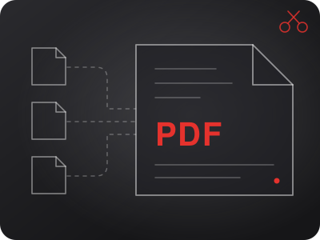
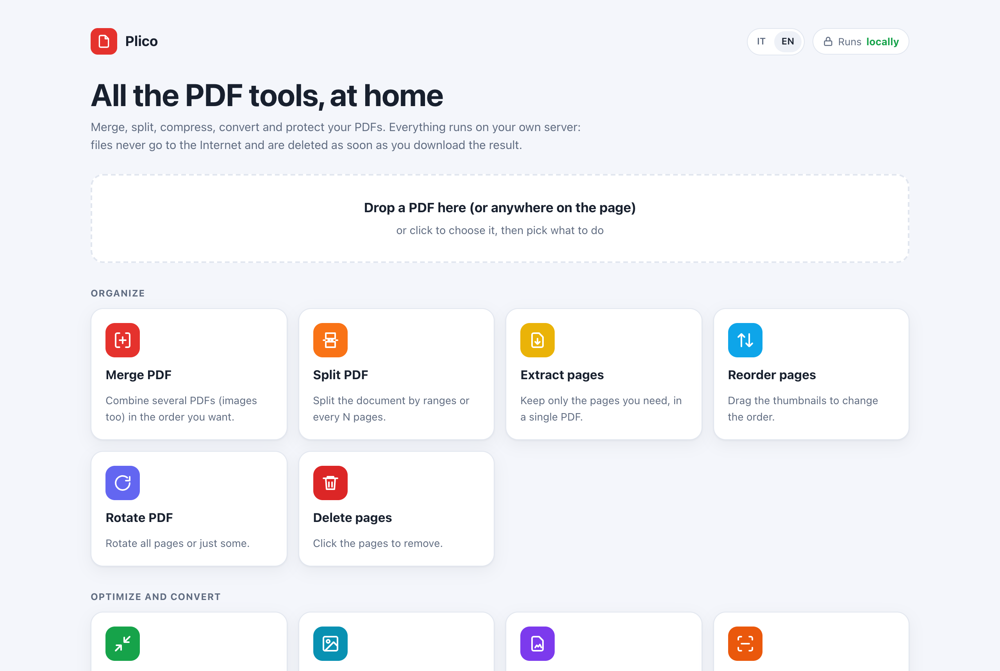

# Universal-PDF

<p align="center"></p>

🇬🇧 [English](README.md) · 🇮🇹 **Italiano**

> **Lavori in corso — repository privato.** Gira su un homelab; alcuni limiti vanno sistemati prima di pubblicarlo. L'elenco è nel [README in inglese](README.md#to-do-before-publishing).

**Strumenti PDF self-hosted in una sola pagina web.** Unisci, dividi, estrai, riordina, ruota, elimina pagine, comprimi, converti tra PDF e immagini, proteggi o sblocca con password, aggiungi numeri di pagina e filigrane. Tutto gira sul tuo server: ogni richiesta lavora in una cartella temporanea che viene cancellata appena il risultato è stato inviato, quindi **sul server non resta nessun file**.

<p align="center">
<picture>
  <source media="(prefers-color-scheme: dark)" srcset="docs/screenshot-home-dark.png">
  
</picture>
</p>

L'interfaccia è in italiano e in inglese: segue la lingua del browser e si cambia con il pulsante IT / EN. Anche i messaggi di errore dell'API seguono l'intestazione `Accept-Language`.

## Strumenti

| Gruppo | Strumenti |
|---|---|
| Organizza | Unisci (anche PDF e immagini insieme), Dividi, Estrai pagine, Riordina / ruota / elimina con le miniature |
| Ottimizza e converti | Comprimi, Immagini → PDF, PDF → JPG/PNG, **OCR** (italiano e inglese), **PDF/A-2**, **Scanner** da telefono (bordi trovati e pagina raddrizzata), **Word, Excel, PowerPoint ↔ PDF** tramite il [Convertitore universale](https://github.com/EmaLau/universal-converter), facoltativo |
| Sicurezza | Proteggi con password (AES-256), Sblocca |
| Modifica e firma | Numeri di pagina, **intestazione e piè di pagina** con `{n}`, `{tot}`, `{date}`, `{file}`, filigrana di testo e **logo**; **Firma** disegnata o da immagine; **Compila moduli**; **Annota**; **Oscura** (il testo viene tolto davvero); **Metadati** e pulizia dei dati nascosti |
| Avanzati | **Confronta** due PDF, **Ritaglia e ridimensiona** (tutto in A4, margini, ritaglio automatico), **Più pagine per foglio e opuscolo**, **Estrai immagini e testo**, **Ripara**, **Più file e catene** (anche salvate) |
| Integrazioni | Chiavi API come in Gokapi, **app Nextcloud** (tasto destro → *Strumenti PDF*), **cartella magica** in Nextcloud (facoltative). Guida all'API e ai Comandi rapidi di iPhone in [docs/api.md](docs/api.md) |

## Avvio rapido

Serve Docker con Docker Compose.

```bash
git clone https://github.com/EmaLau/universal-pdf.git
cd universal-pdf
docker compose up -d --build
```

Apri <http://localhost:8080>. Per controllare che tutti gli strumenti funzionino:

```bash
docker compose exec universal-pdf python3 /app/selftest.py
```

Il selftest esegue 21 controlli sul server in funzione e salva alcuni risultati di esempio in `/work/selftest/` dentro il container.

> **Sicurezza.** Il servizio non ha login e di base ascolta solo su `127.0.0.1`. Aprilo alla rete solo se la rete è fidata (casa, VPN), oppure mettilo dietro un reverse proxy con autenticazione. Non esporlo direttamente su Internet.

## Configurazione

Copia `.env.example` in `.env` e cambia quello che serve.

| Variabile | Predefinito | Descrizione |
|---|---|---|
| `UPDF_BIND` / `UPDF_PORT` | `127.0.0.1` / `8080` | Dove pubblicare il servizio (`0.0.0.0` per tutta la rete) |
| `UPDF_ADMIN_PASSWORD` | vuota | Password della pagina `/admin` dove si gestiscono le chiavi API. Vuota = pagina disattivata. Si può anche scrivere nel file `admin-password` dentro `DATA_DIR` |
| `UPDF_ADMIN_LOGIN` | `true` | Valore iniziale dell'interruttore *password per l'area admin*. `false` = la pagina `/admin` si apre senza password, quindi chiunque raggiunga il servizio gestisce le chiavi. L'interruttore nella pagina `/admin` ha la precedenza e viene ricordato |
| `API_REQUIRE_KEY` | `false` | Valore iniziale dell'interruttore *chiave obbligatoria*: `true` = le chiamate fatte fuori dalla pagina web richiedono una chiave. L'interruttore nella pagina `/admin` ha la precedenza e viene ricordato |
| `DATA_DIR` | `/work/data` | Dove si salvano le chiavi API (solo l'hash SHA-256) e il segreto per firmare i cookie |
| `CONVERTER_URL` | vuota | Indirizzo del Convertitore universale per Word, Excel, PowerPoint ↔ PDF. Vuota = strumenti nascosti |
| `NEXTCLOUD_URL` / `NEXTCLOUD_USER` / `NEXTCLOUD_PASSWORD` | vuote | Attivano la cartella magica (usa una password per le app); `NEXTCLOUD_MAGIC_DIR` e `NEXTCLOUD_POLL_SECONDS` per nome e frequenza |
| `NEXTCLOUD_PASSWORD_FILE` | vuota | Legge la password per le app da un file (segreti di Docker) |
| `MAX_UPLOAD_MB` | `0` | Dimensione massima di ogni file caricato; `0` = nessun limite |
| `MAX_OUTPUT_MB` | `4096` | Dimensione massima dei risultati di una richiesta (es. tutte le immagini di *PDF in immagini*) |
| `MAX_PARALLEL` | `2` | Lavori pesanti eseguiti insieme; gli altri aspettano il loro turno |
| `MAX_PAGE_MPX` | `50` | Megapixel massimi per una pagina in *PDF in immagini*: le pagine più grandi vengono rese a dpi più bassi |
| `UPDF_CPUS` / `UPDF_MEMORY` | `4` / `3G` | Limiti di risorse del container |
| `UPDF_UID` / `UPDF_GID` | `1000` | Utente che esegue il servizio nel container |
| `TZ` | `Europe/Rome` | Fuso orario |

## API

La documentazione interattiva è in **`/apidocs`**; l'elenco degli endpoint è anche nel [README in inglese](README.md#api).

Le chiavi API funzionano come in Gokapi: imposta `UPDF_ADMIN_PASSWORD`, apri **`/admin`** e crea una chiave con un nome e i permessi che servono (uno per strumento). La chiave si vede una sola volta; poi la mandi nell'intestazione `apikey`:

```bash
# unisci due PDF
curl -H "apikey: updf_..." -F files=@a.pdf -F files=@b.pdf -o unito.pdf http://localhost:8080/api/merge
```

La pagina web non ha bisogno della chiave. Con l'interruttore *Chiave obbligatoria per le API* attivo in `/admin` (valore iniziale da `API_REQUIRE_KEY`) le chiamate senza chiave fatte fuori dalla pagina vengono rifiutate (401); una chiave senza il permesso per quello strumento riceve 403.

## Licenza

[GNU Affero General Public License v3.0](LICENSE), la stessa di PyMuPDF. Puoi usare, modificare e ridistribuire il progetto; se lo modifichi e lo offri come servizio di rete, devi rendere disponibile anche il codice delle tue modifiche.
