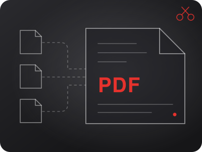
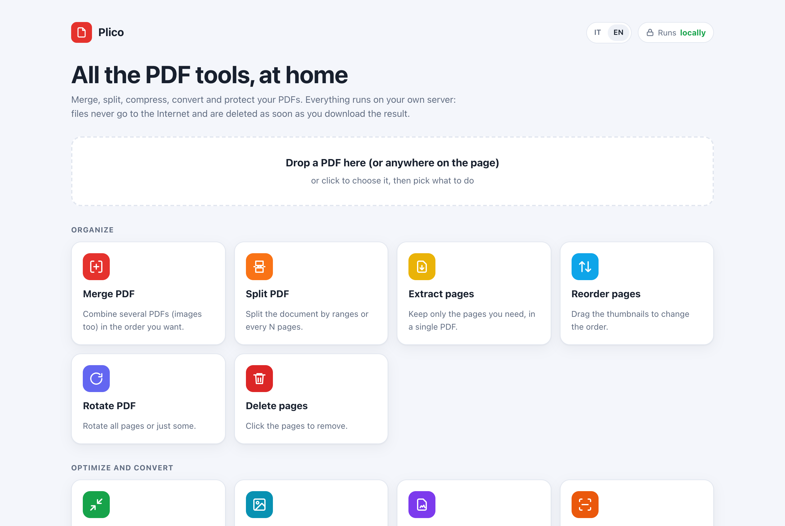
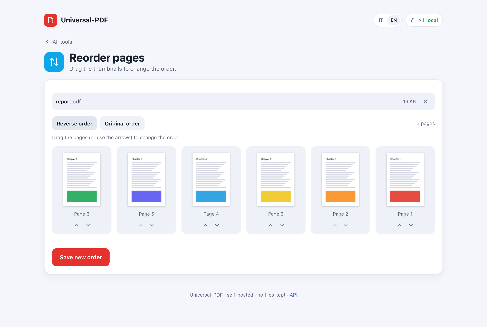

# Universal-PDF

<p align="center"></p>

🇬🇧 **English** · 🇮🇹 [Italiano](README.it.md)

> **Work in progress — private repository.** It runs on one homelab; a few limits must be fixed before publishing. See [To do before publishing](#to-do-before-publishing).

**Self-hosted PDF tools on a single web page.** Merge, split, extract, reorder, rotate, delete pages, compress, convert between PDF and images, protect or unlock with a password, add page numbers and watermarks. Everything runs on your own server: each request works in a temporary folder that is deleted as soon as the result has been sent, so **no file stays on the server**.


[](https://github.com/EmaLau/universal-pdf/actions/workflows/ci.yml)

<p align="center">
<picture>
  <source media="(prefers-color-scheme: dark)" srcset="docs/screenshot-home-dark.png">
  
</picture>
<picture>
  <source media="(prefers-color-scheme: dark)" srcset="docs/screenshot-tool-dark.png">
  
</picture>
</p>

The interface is in English and Italian: it follows the browser language and can be switched with the IT / EN button. Error messages from the API follow the `Accept-Language` header.

## Tools

| Group | Tools |
|---|---|
| Organize | Merge (PDFs and images together), Split (by ranges or every N pages), Extract pages, Reorder / rotate / delete with page thumbnails, Rotate pages |
| Optimize and convert | Compress (three levels, optional grayscale; never bigger than the original), Images → PDF, PDF → JPG/PNG, **OCR** (Italian and English, with OCRmyPDF and Tesseract), **PDF/A-2** for archiving, **Scanner** (phone photos: edges found, page straightened, colour/grey/black and white), **Word, Excel, PowerPoint ↔ PDF** through an optional [Universal Converter](https://github.com/EmaLau/universal-converter) |
| Security | Protect with a password (AES-256, random owner password), Unlock |
| Edit and sign | Page numbers, **header and footer** with `{n}`, `{tot}`, `{date}`, `{file}`, text watermark and **image/logo watermark**; **Sign** (draw it or use an image, place it on the page); **Fill forms** and optionally flatten them; **Annotate** (highlighter, boxes, text, notes, arrows, freehand); **Redact** (text really removed, presets for email, phone, IBAN, Italian tax code, card numbers, or areas drawn on the page); **Metadata** and removal of hidden data |
| Advanced | **Compare** two PDFs (report with changed words and pages side by side, differences in red), **Crop and resize** (all pages to A4, fixed margins, automatic trim), **N-up and booklet**, **Extract images and text**, **Repair** damaged PDFs, **Batch and chains** (several operations in a row, also on many files, result as ZIP; chains can be saved) |
| Integrations | API keys like Gokapi, **Nextcloud app** (right click → *Strumenti PDF*), Nextcloud **magic folder** that processes PDFs by itself (both optional) |

## Quick start

You need Docker with Docker Compose.

```bash
git clone https://github.com/EmaLau/universal-pdf.git
cd universal-pdf
docker compose up -d --build
```

Open <http://localhost:8080>. To check that every tool works:

```bash
docker compose exec universal-pdf python3 /app/selftest.py
```

The selftest runs about 30 checks (some only when the related setting is enabled) against the live server and saves sample results in `/work/selftest/` inside the container.

> **Security note.** The web page has no login and by default the service listens only on `127.0.0.1`. API keys (below) control scripts, not the page. Open it to the network only if the network is trusted (home, VPN), or put it behind a reverse proxy with authentication. Do not expose it directly to the Internet.

## Configuration

Copy `.env.example` to `.env` and change what you need.

| Variable | Default | Description |
|---|---|---|
| `UPDF_BIND` / `UPDF_PORT` | `127.0.0.1` / `8080` | Where to publish the service (`0.0.0.0` for the whole network) |
| `MAX_UPLOAD_MB` | `0` | Maximum size of each uploaded file; `0` means no limit |
| `MAX_OUTPUT_MB` | `4096` | Maximum total size of the results of one request (e.g. all the images of *PDF to images*) |
| `MAX_PARALLEL` | `2` | Heavy jobs run at the same time; the others wait their turn |
| `MAX_PAGE_MPX` | `50` | Maximum megapixels for a page rendered by *PDF to images*: larger pages get a lower DPI |
| `UPDF_CPUS` / `UPDF_MEMORY` | `4` / `3G` | Container resource limits |
| `UPDF_ADMIN_PASSWORD` | empty | Password of the `/admin` page where API keys are managed. Empty = admin page disabled. It can also be written in the file `admin-password` inside `DATA_DIR` |
| `UPDF_ADMIN_LOGIN` | `true` | Initial value of the *admin password* switch. `false` = the `/admin` page opens without a password, so anyone who can reach the service can manage keys. The switch on `/admin` overrides it and is remembered |
| `API_REQUIRE_KEY` | `false` | Initial value of the *key required* switch: `true` = API calls made outside the web page need an API key. The switch on the `/admin` page overrides it and is remembered |
| `DATA_DIR` | `/work/data` | Where API keys (only their SHA-256 hashes) and the signing secret are stored |
| `CONVERTER_URL` | empty | Address of a [Universal Converter](https://github.com/EmaLau/universal-converter) for Word, Excel, PowerPoint ↔ PDF (e.g. `http://converter:8080`). Empty = those tools are hidden |
| `CONVERTER_API_KEY` | empty | Sent as `apikey` to the converter, if it needs one |
| `NEXTCLOUD_URL` / `NEXTCLOUD_USER` / `NEXTCLOUD_PASSWORD` | empty | Turn on the [magic folder](#nextcloud) (use an app password) |
| `NEXTCLOUD_PASSWORD_FILE` | empty | Read the app password from a file instead (Docker secrets) |
| `NEXTCLOUD_MAGIC_DIR` / `NEXTCLOUD_POLL_SECONDS` | `Universal-PDF` / `60` | Magic folder name and how often it is checked |
| `UPDF_UID` / `UPDF_GID` | `1000` | User that runs the service inside the container |
| `TZ` | `Europe/Rome` | Time zone |

## API

Interactive documentation (Swagger UI) is at **`/apidocs`**, the OpenAPI schema at `/apidocs/openapi.json`.

### API keys

API keys work like in [Gokapi](https://github.com/Forceu/Gokapi):

1. Set `UPDF_ADMIN_PASSWORD` and open **`/admin`**.
2. Create a key with a name and the permissions it needs, one per tool (`info`, `merge`, `split`, `organize`, `rotate`, `compress`, `img2pdf`, `pdf2img`, `protect`, `stamp`). The full key is shown only once; the server keeps its SHA-256 hash, the last time it was used, and lets you change permissions or revoke it.
3. Send it in the `apikey` header:

```bash
curl -H "apikey: updf_..." -F files=@a.pdf -F files=@b.pdf -o merged.pdf http://localhost:8080/api/merge
```

A wrong or revoked key gets `401`, a key without the permission for that tool gets `403`; both are checked before the upload is received. The web page does not need a key: opening it sets a signed session cookie. When *Key required for the API* is switched on in `/admin` (initial value from `API_REQUIRE_KEY`), calls with neither a key nor that cookie get `401`. Anyone who can open the page can still get the cookie, so this keeps scripts in order; it is not a protection against people who can reach the service.

### Endpoints

The complete reference, with examples for curl, Python and iPhone Shortcuts, is in **[docs/api.md](docs/api.md)**; the live one is at `/apidocs`.

All endpoints are `POST` with `multipart/form-data`. They answer with the resulting file, or with JSON `{"detail": "..."}` and an HTTP error code.

| Endpoint | Fields | Result |
|---|---|---|
| `/api/info` | `file` | `{"pages", "encrypted", "size"}` |
| `/api/thumbs` | `file`, `width` | `{"pages": [{"w", "h", "rot", "img"}]}` (`img` is a JPEG data URL) |
| `/api/merge` | `files` (2 or more, PDFs or images) | PDF |
| `/api/split` | `file`, `mode` (`ranges` or `every`), `ranges` (`1-3, 5, 8-`), `every`, `merge_out` | ZIP, or PDF if there is a single output |
| `/api/organize` | `file`, `pages` (JSON `[[index, rotation], ...]`, 0-based) | PDF |
| `/api/rotate` | `file`, `angle` | PDF |
| `/api/compress` | `file`, `level` (`low`, `medium`, `high`), `gray` | PDF, with headers `X-Size-Before` / `X-Size-After` |
| `/api/img2pdf` | `files`, `page` (`fit`, `a4`, `letter`), `margin` | PDF |
| `/api/pdf2img` | `file`, `format` (`png`, `jpg`), `dpi`, `ranges` | ZIP, or an image for a single page. Pages that would exceed `MAX_PAGE_MPX` are rendered at a lower DPI and counted in the `X-Dpi-Reduced` header |
| `/api/protect` | `file`, `password`, `owner`, `allow_print`, `allow_copy`, `allow_edit` | PDF (AES-256). Without `owner`, a random owner password is generated, so the permissions are enforced |
| `/api/unlock` | `file`, `password` | PDF |
| `/api/stamp` | `file`, `numbers`, `num_pos`, `num_fmt`, `num_start`, `num_size`, `num_skip_first`, `watermark`, `wm_size`, `wm_opacity`, `wm_angle`, `wm_color`, `header`, `footer`, `hf_size`, `wm_image`, `wm_image_scale` | PDF |
| `/api/ocr` | `file`, `lang` (`ita`, `eng`, `ita+eng`), `force`, `deskew` | PDF with a text layer |
| `/api/pdfa` | `file`, `ocr_text`, `lang` | PDF/A-2 |
| `/api/sign` | `file`, `image`, `page`, `box` | PDF |
| `/api/annotate` | `file`, `items` (JSON), `flatten` | PDF |
| `/api/forms` · `/api/fill` | `file` · `file`, `values` (JSON), `flatten` | fields as JSON · PDF |
| `/api/redact` | `file`, `terms`, `presets`, `areas` (JSON), `regex`, `clean_metadata` | PDF, header `X-Redactions` |
| `/api/compare` | `file_a`, `file_b` | PDF report, header `X-Pages-Changed` |
| `/api/pages` | `file`, `mode` (`resize`, `crop`, `trim`), `paper`, margins | PDF |
| `/api/nup` | `file`, `mode` (`nup`, `booklet`), `n`, `paper` | PDF |
| `/api/extract` | `file`, `kind` (`images`, `text`), `pages` | ZIP or TXT |
| `/api/repair` · `/api/metadata` | `file` · `file`, `clean`, `title`, `author`, … | PDF |
| `/api/scan` | `files` (photos), `mode` (`color`, `gray`, `bw`), `paper` | PDF |
| `/api/office` | `file`, `target` (`pdf`, `docx`, `odt`, `xlsx`, `pptx`, `txt`) | converted file (needs `CONVERTER_URL`) |
| `/api/chain` | `files`, `steps` (JSON) or `chain` (saved chain) | PDF, or ZIP for several files |

`GET /healthz` returns `{"ok": true}`.

```bash
# merge two PDFs
curl -F files=@a.pdf -F files=@b.pdf -o merged.pdf http://localhost:8080/api/merge

# compress
curl -F file=@scan.pdf -F level=high -o smaller.pdf http://localhost:8080/api/compress
```

## Nextcloud

Both integrations are optional; the service works without Nextcloud.

**Right click → Strumenti PDF.** The app in [`nextcloud-app/`](nextcloud-app) (Nextcloud 30–36) adds a *Strumenti PDF* submenu to PDF files: merge the selected files, compress, OCR, number pages, rotate, protect or unlock, remove hidden data, PDF/A, repair, and every saved chain. The result is saved next to the original.

```bash
cp -r nextcloud-app /path/to/nextcloud/custom_apps/strumentipdf
occ app:enable strumentipdf
occ config:app:set strumentipdf pdf_url --value=http://universal-pdf-address:8080
occ config:app:set strumentipdf api_key --value=updf_...      # if the server requires a key
occ config:system:set allow_local_remote_servers --value=true --type=boolean   # if the address is on the local network
```

**Magic folder.** With `NEXTCLOUD_URL`, `NEXTCLOUD_USER` and `NEXTCLOUD_PASSWORD` (an app password) the server watches the folder `Universal-PDF/` of that user. Every saved chain with *magic folder* switched on in `/admin` gets a subfolder: drop a PDF in `Universal-PDF/<chain>/` and within a minute the result appears in `Fatti/`, the original moves to `Originali/`, and a file that cannot be processed goes to `Errori/` with a `.txt` explaining why.

## How it works

- **FastAPI** server (`server/server.py`) with a single static page (`server/static/index.html`, no build step and no external resources).
- **PyMuPDF** for pages, thumbnails, images and stamps; **pikepdf** for encryption; **Ghostscript** for compression.
- Each request creates a folder under `/work/upd`, and a background task removes it once the response has been sent. Leftovers from an interrupted run are removed when the service starts.
- API keys and the `/admin` page are in `server/apikeys.py` and `server/static/admin.html`.
- Security headers on every response: a Content-Security-Policy that allows only the page's own scripts (by hash), `frame-ancestors 'none'`, `nosniff`, no referrer. Requests that change something and come from another site's page (`Origin` / `Sec-Fetch-Site`) are rejected with 403.
- The interface texts are in `server/static/i18n.js`, the API error messages in `server/i18n.py`.
- The container runs as an unprivileged user, behind `tini`.

## Project layout

```
server/
  Dockerfile       Debian trixie + Python, PyMuPDF, pikepdf, Ghostscript
  server.py        API and page
  apikeys.py       API keys and /admin login
  ops.py           the PDF operations, shared by the API, chains and the magic folder
  chains.py        saved chains
  magic.py         Nextcloud magic folder (WebDAV)
  converter.py     Office <-> PDF through Universal Converter
  i18n.py          English translations of the error messages
  static/          the web page (index.html) and the admin page (admin.html)
  selftest.py      real test of every tool against the running server
  requirements.txt pinned Python dependencies
nextcloud-app/     the Nextcloud app (right click -> Strumenti PDF)
docs/api.md        API reference and iPhone Shortcuts guide
tests/
  test_features.py tests of the phase-4 tools, chains, Office and magic folder (with fakes)
  test_api.py      API tests with FastAPI's TestClient (no container)
  test_ui.py       every tool driven from the page in headless Chromium (Playwright)
.github/workflows/ci.yml   pytest + Docker build + selftest on every push
docker-compose.yml
.env.example
```

## Development

```bash
python3.13 -m venv .venv && . .venv/bin/activate
pip install -r requirements-dev.txt
python -m playwright install chromium   # or use your Chrome: PW_CHANNEL=chrome
python -m pytest                        # needs Ghostscript installed for the compress test
```

The same tests run in GitHub Actions, together with a Docker build and the selftest inside the container.

## To do before publishing

- [x] Cap the pixel size of each page in PDF → images: a tiny PDF with a huge page can exhaust the container memory
- [x] Random owner password when none is given
- [x] `/api/info`: answer 413, not 400, for files over the limit; fix the `/api/thumbs` response in the docs (`img`, `rot`)
- [x] Uploads are spooled to the data volume, not to the container filesystem; limit on output size
- [x] Limit on parallel heavy jobs
- [x] pytest tests, browser test of the page, CI
- [x] English or bilingual interface, security headers
- [x] OCR, signature, forms, annotations, redaction, compare, crop/resize, n-up/booklet, image watermark and header/footer, repair, PDF/A, metadata, extract, scanner, batch and chains, Office via the converter, Nextcloud app and magic folder, API guide
- [ ] Review the name and make sure nothing is copied from the site that inspired it

## License

[GNU Affero General Public License v3.0](LICENSE), the same licence as PyMuPDF. You are free to use, modify and redistribute the project. If you modify it and offer it as a network service, you must also make the source code of your changes available.
